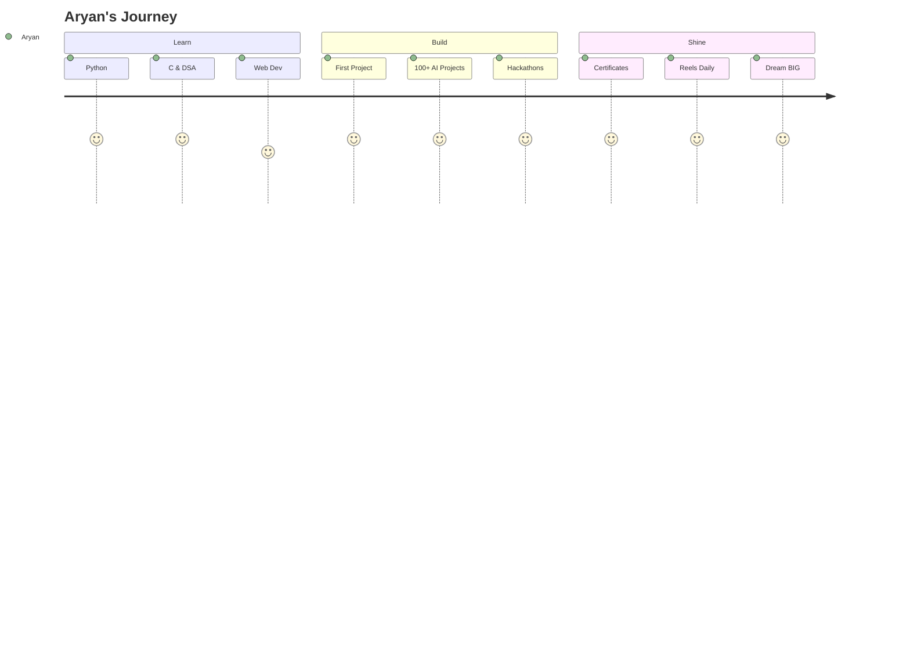

<div align="center">

<!-- ═══════════════════════════════════════════════════════════════════════════════ -->
<!--  👋  HI, I'M ARYAN KUMAR SHAH  —  ASPIRING SOFTWARE DEVELOPER  —  INSANE LEVEL  -->
<!-- ═══════════════════════════════════════════════════════════════════════════════ -->


[](https://github.com/aryancodes-dev)

### 🌟 *BCA 1st Year • MAKAUT (PITM, Kolkata) • Building real projects, learning in public, shipping every day.* 🌟


[](https://github.com/aryancodes-dev)
[](https://aryancodes-dev.github.io/)
[](https://github.com/aryancodes-dev)

[](https://aryancodes-dev.github.io/)
[](https://github.com/aryancodes-dev)
[](https://www.linkedin.com/in/aryan-kumar-shah-933222443)
[](https://www.youtube.com/@aryancodes_dev)
[](https://www.instagram.com/aryancodes_dev)
[](https://x.com/aryancodes_dev)
[](https://www.threads.net/@aryancodes_dev)


</div>

---

<div align="center">

# ✨ About Me ✨

</div>

<div align="center">

| 🎓 | 💻 | 🚀 | 🎯 | 🌙 |
|:---:|:---:|:---:|:---:|:---:|
| **BCA Student** | **Software Developer** | **Open Source Builder** | **Content Creator** | **Dreamer, BIG** |

</div>


I'm **Aryan Kumar Shah**, a BCA 1st-year student at **MAKAUT — Prajnanananda Institute of Technology and Management, Kolkata (2026–2030)**.

I don't just learn to code — **I build real things and ship them.** Every project here is live, open-source, and actually used. I learn in public on **[@aryancodes_dev](https://www.youtube.com/@aryancodes_dev)** — tricky coding questions, AI prompts, and free certificates, **2 reels a day, never missing a day**.

> ## 💜 *My rule:*
> ## *Think BIG and ADVANCED, never small.*
> ## *Finish Web + PWA + open-source code + live site together, in one go.*

```python
# whoami.py — run it, you'll see
class AryanKumarShah:
    def __init__(self):
        self.name = "Aryan Kumar Shah"
        self.role = "Aspiring Software Developer"
        self.college = "MAKAUT (PITM, Kolkata)"
        self.degree = "BCA (2026–2030)"
        self.mission = "Build real things. Learn in public. Never stop shipping."
        self.daily = "2 reels a day on @aryancodes_dev"
        self.certificates = "40+ and counting 🏆"
        self.projects = "Live. Real. Open source. 🚀"

    def motto(self):
        return "Think BIG. Build BIG. Ship BIG."

aryan = AryanKumarShah()
print(aryan.motto())  # Think BIG. Build BIG. Ship BIG.
```

<div align="center">

### 🔢 My Journey in Numbers

| | | | |
|:---:|:---:|:---:|:---:|
| **40+**<br/>🏆 Certificates | **15+**<br/>🚀 Projects Built | **100+**<br/>💻 AI Projects Series | **2 / day**<br/>📺 Reels, Every Day |

</div>


---

<div align="center">

# 📚 What I Learned — And Proved With Certificates 🏆

<div align="center">

[](https://github.com/aryancodes-dev)


</div>

</div>

> ### I learn a skill, I practise it, I build with it — and I prove it with a certificate.
> ### **HackerRank is where I learned and got certified — not where I earn money.** Every certificate below is a skill I learned and passed a test for. 💚

<div align="center">

## 🌟 Top Certificates 🌟

| 🏅 Certificate | 📅 Passed | ✅ Score |
|:---|:---:|:---:|
| **Oracle Agentic AI Foundations Associate** (1Z0-1157-26) | 20 Nov 2026 | **98%** |
| **Oracle AI Database Foundations Associate** (1Z0-1195-26) | 24 Nov 2026 | **100%** |
| **freeCodeCamp Python Certification** | 11 Nov 2026 | **94%** (47/50) |
| **Microsoft Foundational C#** | 9 Nov 2026 | **76/80** |
| **Harvard CS50P — CS50's Introduction to Programming with Python** | 2026 | **Certificate earned** |
| **OpenAI Academy — Build with AI: Codex Pathway** | 22 Nov 2026 | **100% / 100% / 90%** |
| **AWS — Introduction to Generative AI: Art of the Possible** | 18 Nov 2026 | **Completed** |

</div>

### 🟢 HackerRank — Skills I Learned & Got Certified In

| Skill | Level | Skill | Level |
|:---|:---:|:---|:---:|
| **Problem Solving** | Basic | **Problem Solving** | Intermediate |
| **SQL** | Basic | **SQL** | Intermediate |
| **SQL** | Advanced | **Java** | Basic |
| **JavaScript** | Basic | **JavaScript** | Intermediate |
| **Node.js** | Basic | **Node.js** | Intermediate |
| **React** | Basic | **Go (Golang)** | Basic |
| **Go (Golang)** | Intermediate | **REST API** | Intermediate |
| **Angular** | Basic | **Angular** | Intermediate |
| **C#** | Basic | **CSS** | Basic |
| **Frontend Developer (React)** | Role | **Software Engineer Intern** | Role |

> Plus: **HackerRank Orchestrate** — completed. 🏅

### 📊 Kaggle — Data Skills I Learned

| Certificate |
|:---|
| **Python** — Kaggle |
| **Intro to SQL** — Kaggle |
| **Advanced SQL** — Kaggle |

### 🤖 AI & Cloud — What I Learned

| Certificate / Badge | From |
|:---|:---|
| **Introduction to Generative AI** | Google Skills |
| **Introduction to Large Language Models** | Google Skills |
| **Claude Code in Action** | Claude Academy |
| **Introduction to Model Context Protocol** | Claude Academy |
| **Get Started with Codex** | OpenAI Academy |
| **Extend Codex Workflows** | OpenAI Academy |
| **Scale Codex Across Teams** | OpenAI Academy |
| **AI Tools & Claude Workshop** | Be10x — 15 Nov 2026 |
| **Introduction to Generative AI — Art of the Possible** | AWS Training & Certification |

### 🎓 Learning Simulations (Learning Only)

| Simulation | From | Note |
|:---|:---|:---|
| **Cyber Job Simulation** | Forage — Deloitte | Learning only, 19 Nov 2026 — not a real internship |
| **GenAI for Proposal Generation Job Simulation** | Forage — EAB | Learning only, 19 Nov 2026 — not a real internship |

### 🏅 Quiz & Community

| Achievement | From |
|:---|:---|
| **Certificate of Excellence — AI Quiz Off 2026** | ChatGPT / QuizOff (Team Aryan Kumar Shah, PITM Kolkata) |
| **Certificate of Participation — AI Quiz Off 2026** | ChatGPT / QuizOff |

<div align="center">

*🎯 Currently working towards: **Microsoft DP-800** (Azure SQL Database Developer Associate) — 100% voucher, exam by 31 Dec 2026.*

</div>


---

<div align="center">

# 🚀 Projects I Made — All Live, All Real ✨

<div align="center">


</div>

</div>

<div align="center">

| # | 🛠️ Project | 💡 What it does | 🔗 Links |
|:---:|:---|:---|:---|
| 01 | **ContextHop** | Context-aware AI memory for Python — remember what matters, forget what doesn't | [PyPI](https://pypi.org/project/contexthop/) • [GitHub](https://github.com/aryancodes-dev/contexthop) |
| 02 | **DryRun** | Predict-the-output trainer — 19 gcc-verified C questions, learn by dry-running code | [Live](https://aryancodes-dev.github.io/dryrun/) • [GitHub](https://github.com/aryancodes-dev/dryrun) |
| 03 | **CampusDesk** | Pure-Java campus management — students, courses, attendance, fees | [GitHub](https://github.com/aryancodes-dev/campusdesk) |
| 04 | **NoticeBandhu** | College notices, simplified — every notice, one place, always on time | [Live](https://aryancodes-dev.github.io/noticebandhu/) • [GitHub](https://github.com/aryancodes-dev/noticebandhu) |
| 05 | **MyWorkProof** | Proof of work, beautifully — track and showcase what you actually built | [GitHub](https://github.com/aryancodes-dev/myworkproof) |

</div>

### 💻 100+ AI Projects Series — Projects I Made

| # | Project | What it is |
|:---:|:---|:---|
| 01 | **Lumora** (formerly Mochi) | Simple AI chatbot — no API key, works offline, Web + App + Python • [Live](https://aryancodes-dev.github.io/Lumora/) • [GitHub](https://github.com/aryancodes-dev/Lumora) |
| 02 | **Tic-Tac-Toe with AI** | Unbeatable Minimax AI, boards 3×3 to 15×15 • [GitHub](https://github.com/aryancodes-dev/tic-tac-toe-ai) |
| 03 | **Autocorrect** | Advanced autocorrect tool, v20 |
| 04 | **Translator App** | 9 languages, offline backup + speak, v20 • [GitHub](https://github.com/aryancodes-dev/translator-app) |
| 05 | **Spam Email Classifier** | Spam score + reasons, v20 • [GitHub](https://github.com/aryancodes-dev/spam-email-classifier) |
| 06 | **Smart Email Sorter** | *Next in the series* |

### 🌙 Also Building — Bigger, Every Day

| Project | What it is |
|:---|:---|
| 🌙 **Lofi PLAYBOOK** | Midnight lofi music hub — Hindi slowed + reverb songs for rainy nights • [Live](https://lofiplaybook.xyz/) • [GitHub](https://github.com/aryancodes-dev/Lofi-PLAYBOOK) |
| 🧭 **Pathfinder** | From confusion to completion — universal procedure finder for India, verified roadmaps • [GitHub](https://github.com/aryancodes-dev/pathfinder) |
| 🎓 **StudySOS** | Study less randomly, prepare more intelligently — AI exam prep platform • [GitHub](https://github.com/aryancodes-dev/studysos) |
| 🥽 **ReviseLens** | AR flashcards — 5 C flashcards on your desk in AR • [Devpost](https://devpost.com/software/reviselens) • [GitHub](https://github.com/aryancodes-dev/reviselens) |
| 🎯 **GHOSTLINE** | VALORANT tactical scouting — real-match analysis, fully original (Cloud9 × JetBrains Hackathon) |
| ✂️ **EditPop** | AI auto-captions app for Android — rebuilt from scratch |


---

<div align="center">

# 🔮 3 Upcoming Projects — Coming Next, BIG 🚀

<div align="center">

[](https://github.com/aryancodes-dev)


</div>

</div>

<div align="center">

| # | 🚀 Project | 💡 What it will be |
|:---:|:---|:---|
| **1** | **🤖 AI Campus OS for India** | A complete AI operating system for Indian campuses — notices, attendance, exams, AI mentor, everything in one place |
| **2** | **🧑‍🏫 AI Coding Mentor Platform** | Your personal AI coding mentor — learn, practise, get unstuck, and grow from beginner to job-ready |
| **3** | **🛍️ AI WhatsApp Shop OS** | Run a whole shop on WhatsApp with AI — catalogue, orders, payments, customers, all automatic |

*Built one by one, in this order — Web + PWA + open-source code + live site together, in one go. No small projects. Only BIG.* 🚀

</div>


---

<div align="center">

# 🛠️ Tech Stack

<div align="center">

[](https://github.com/aryancodes-dev)

</div>

<div align="center">


</div>

</div>

<div align="center">

### 💻 Languages I Learned


### 🧰 Tools & Platforms


### 🌱 Currently Learning


</div>


---

<div align="center">

# 📊 GitHub Stats — Watch Me Grow 📈

<div align="center">

[](https://github.com/aryancodes-dev)

</div>

</div>

<div align="center">


</div>


---

<div align="center">

# 🌐 Everywhere I Am — All My Accounts & Links ✨

<div align="center">

[](https://github.com/aryancodes-dev)


</div>

</div>

### 🎬 Video & Content — @aryancodes_dev (Tech) • @gamerzgtaa (Gaming) • @LofiPLAYBOOK (Music)

| Platform | Account | Link |
|:---|:---|:---|
| ▶️ **YouTube — Tech** | AryanCodesDev — @aryancodes_dev | [youtube.com/@aryancodes_dev](https://www.youtube.com/@aryancodes_dev) |
| ▶️ **YouTube — Gaming** | Gamerzgtaa — @gamerzgtaa | [youtube.com/@gamerzgtaa](https://www.youtube.com/@gamerzgtaa) |
| ▶️ **YouTube — Music** | LofiPLAYBOOK — @LofiPLAYBOOK | [youtube.com/@LofiPLAYBOOK](https://www.youtube.com/@LofiPLAYBOOK) |
| 📸 **Instagram — Tech** | @aryancodes_dev | [instagram.com/aryancodes_dev](https://www.instagram.com/aryancodes_dev) |
| 📸 **Instagram — Gaming** | @gamerzgtaa | [instagram.com/gamerzgtaa](https://www.instagram.com/gamerzgtaa) |
| 📸 **Instagram — Personal** | shiv_aryan | Personal account — kept off professional profiles |
| 👍 **Facebook — Tech** | Aryan Codes Dev | Facebook — @aryancodes_dev |
| 👍 **Facebook — Gaming** | Gamerzgta A | Facebook — @gamerzgtaa |
| 🧵 **Threads** | @aryancodes_dev | [threads.net/@aryancodes_dev](https://www.threads.net/@aryancodes_dev) |
| 𝕏 **X (Twitter)** | @aryancodes_dev | [x.com/aryancodes_dev](https://x.com/aryancodes_dev) |
| 💼 **LinkedIn** | Aryan Kumar Shah | [linkedin.com/in/aryan-kumar-shah-933222443](https://www.linkedin.com/in/aryan-kumar-shah-933222443) |

### 💻 Code, Learning & Developer Profiles

| Platform | Account / Handle | Link |
|:---|:---|:---|
| 🐙 **GitHub** | aryancodes-dev | [github.com/aryancodes-dev](https://github.com/aryancodes-dev) |
| 🌐 **Portfolio** | aryancodes-dev.github.io | [aryancodes-dev.github.io](https://aryancodes-dev.github.io/) |
| 🌙 **Lofi PLAYBOOK** | lofiplaybook.xyz | [lofiplaybook.xyz](https://lofiplaybook.xyz/) |
| 📦 **PyPI** | contexthop | [pypi.org/project/contexthop](https://pypi.org/project/contexthop/) |
| 📝 **Dev.to** | aryancodes-dev | Dev.to — @aryancodes_dev |
| 💻 **LeetCode** | aryancodes-dev | LeetCode — public profile |
| 🟧 **Stack Overflow** | ID 33234010 | Stack Overflow — ID 33234010 |
| 🟢 **HackerRank** | Aryan Kumar Shah | HackerRank — where I learned & got certified |
| 🏆 **Devpost** | aryancodes-dev | [devpost.com/software/reviselens](https://devpost.com/software/reviselens) |
| 🎯 **Unstop** | Aryan Kumar Shah | Unstop — hackathons & quizzes |
| 👥 **GDG Kolkata** | Member | Google Developer Groups, Kolkata |
| 🎓 **Microsoft Learn** | AryanKumarShah-1399 | Microsoft Learn |
| 🎓 **Google Skills** | Public profile | [skills.google/public_profiles/225eb267-2c09-47ee-a5c0-b311e5a4b702](https://www.skills.google/public_profiles/225eb267-2c09-47ee-a5c0-b311e5a4b702) |
| ☁️ **AWS Builder Center** | @aryancodesdev | AWS Builder Center |
| 📊 **Kaggle** | Aryan Kumar Shah | Kaggle — Python & SQL certificates |
| 🎓 **Harvard CS50** | CS50x / CS50P | cs50.harvard.edu |
| 💻 **freeCodeCamp** | Aryan Kumar Shah | freeCodeCamp — Python & C# certificates |

### 💬 Community & More

| Platform | Account |
|:---|:---|
| ✈️ **Telegram** | A. K Funn (AKFUNNNN Premium) — private channel |
| 🎵 **Lofi PLAYBOOK** | Contact: lofiplaybook007@gmail.com |

> **2 reels a day, every day** on @aryancodes_dev — tricky coding questions, tricky AI prompts, and free certificates. Gaming clips only on @gamerzgtaa. Music only on @LofiPLAYBOOK. 🎬


---

<div align="center">

# 🌈 My Coding Journey

</div>

<div align="center">



*2026 — Started BCA at MAKAUT → Built 15+ real projects → 40+ certificates → 50+ hackathons & quizzes → 2 reels a day → And this is only the beginning.* ✨

</div>

---

<div align="center">

# 🏆 Hackathons, Quizzes & Challenges — I Join Them All 🚀

<div align="center">

[](https://github.com/aryancodes-dev)


</div>

</div>

> ### I don't just watch hackathons — I join them. A lot of them.
> ### Quizzes, hackathons, CTFs, AI challenges, buildathons — if it's there, I fill the form and participate. 💪

### 🎯 Hackathons I Participate In

| Hackathon / Challenge |
|:---|
| **Cloud9 × JetBrains: Sky's The Limit Hackathon 2026** — building GHOSTLINE + C9 SKY CLUTCH |
| **Learn AR with SPECS** — built ReviseLens (AR flashcards) |
| **Configure 2026 — Mobility Hackathon** |
| **India Runs on Voice** |
| **AgntID Agent Security Challenge** |
| **SLAY HACKS 2026** |
| **Hackday 2.0** |
| **CTF Cicada 2026** |
| **OpenCode 2026** |
| **Health Hackathon 3.0** |
| **Hack Era 2.0** |
| **K Hacks 4.0** |
| **National Online Hackathon 2026** |
| **Incursion 2027** |
| **HackZ'26** |
| **AGENTIC X 2.0** |
| **AI Kaushal Hackathon 2026** |
| **Anna AI OS Founding Builder Challenge 2026** |
| **AI Xplore Challenge** |
| **TechZen AI Challenge 2026** |
| **The Black-Box Protocol** |
| **TCU Hack Day** |
| **Hacksprint 3.0** |
| **Goa Buildathon 27** |
| **Skill Hackathon 2027** |
| **AI-Powered Career Development Hackathon** |
| **AgentX Hackathon** |
| **INNOVATE INDIA** |
| **TryHackingMe Hackathon** |
| **Claude Build Challenge 2026** |
| **CyberQuest** |
| **HackUttar Pradesh 2026** |
| **Beyond Limits 2027** |
| **Galuxium Nexus V3** |
| **Ooty Hacks** |
| **AI Vibeathon 1.0** |
| **Nurn 2026** |
| **Starlight Arena** |
| **Neural Nexus 2026** |
| **Rack It Up 2026** |
| **CodeCrafters India 2026** |
| **CodeUnited India** |
| **CodeAstra India 2026** |
| **CodeWarriors India 2026** |
| **CodeEncoders India 2026** |
| **PDH Gemini FrostFest 2026** |
| **ESC AI Quest 2026** |

### 🧠 Quizzes & Challenges I Participate In

| Quiz / Challenge |
|:---|
| **Tech Trivia** |
| **Copilot Clash** |
| **Agents That Act** |
| **AI IQ Challenge** |
| **Claude AI Quiz Challenge** |
| **PromptWars Hyderabad 2026** |
| **Eurogrip Creator Challenge** |
| **Eurogrip Treasure Hunt** |
| **AWS Student AI Bootcamp** |
| **Slay CTF** |
| **CTF Cicada 2026** |

> **50+ applications filled on Unstop alone** — hackathons, quizzes, CTFs, AI challenges, buildathons. I participate in all of them, I learn from all of them, and I keep building. 🔥


---

<div align="center">

# 🎯 What I'm Doing Now

</div>

| | |
|:---|:---|
| 🎓 | **BCA 1st Semester** — MAKAUT, end-sem exams Dec 2026 / Jan 2027 |
| 🏆 | **Cloud9 × JetBrains Hackathon** — building GHOSTLINE + C9 SKY CLUTCH (deadline 13 Jan 2027) |
| 📺 | **Daily reels** — 2 a day on @aryancodes_dev, never missing a day |
| 📜 | **DP-800** — Microsoft Fabric Data Days, exam by 31 Dec 2026 |
| 💻 | **100+ AI Projects** — building every project from the series, one by one |
| 🌙 | **Lofi PLAYBOOK** — growing the midnight lofi hub at [lofiplaybook.xyz](https://lofiplaybook.xyz/) |
| 🔮 | **Next BIG builds** — AI Campus OS → AI Coding Mentor → AI WhatsApp Shop OS |

---

<div align="center">

# 🎉 Fun Facts About Me

</div>

<div align="center">

| 🎉 | |
|:---|:---|
| ☕ | I turn coffee + curiosity into code |
| 🌙 | Best ideas come at midnight — that's why Lofi PLAYBOOK exists |
| 📺 | I never miss a day of reels — 2 a day, every day |
| 🏆 | I joined 50+ hackathons & quizzes in my 1st year itself |
| 💜 | My favourite colour is purple — just look at this profile |

</div>

---

<div align="center">

# 🎯 My Goals

<div align="center">

[](https://github.com/aryancodes-dev)

</div>

</div>

<div align="center">

- [x] Learn Python, C, Java, JavaScript, SQL — and prove it with certificates ✅
- [x] Build 15+ real, live, open-source projects ✅
- [x] Join 50+ hackathons & quizzes ✅
- [x] Start @aryancodes_dev — 2 reels a day ✅
- [ ] Pass Microsoft DP-800 by 31 Dec 2026
- [ ] Win a hackathon — Cloud9 × JetBrains, 13 Jan 2027
- [ ] Build AI Campus OS for India
- [ ] Build AI Coding Mentor Platform
- [ ] Build AI WhatsApp Shop OS
- [ ] Something INSANE in 2–3 years — stay tuned 🚀

</div>

---

<div align="center">

# 📫 Connect With Me

| | |
|:---:|
| 📧 **Email** | arynkmrshh@gmail.com |
| 🌐 **Portfolio** | [aryancodes-dev.github.io](https://aryancodes-dev.github.io/) |
| 💼 **LinkedIn** | [aryan-kumar-shah-933222443](https://www.linkedin.com/in/aryan-kumar-shah-933222443) |
| 🐙 **GitHub** | [aryancodes-dev](https://github.com/aryancodes-dev) |

</div>

---

<div align="center">


### 💜 *Build real things. Learn in public. Never stop shipping.*

### ⭐ *If you like what I build, follow me — and star a repo, it means a lot!* ⭐

### 🚀 *Something INSANE is coming in 2–3 years. Stay tuned.* 🚀

### 💫 *Thank you for visiting my profile — you are awesome!* 💫


</div>
